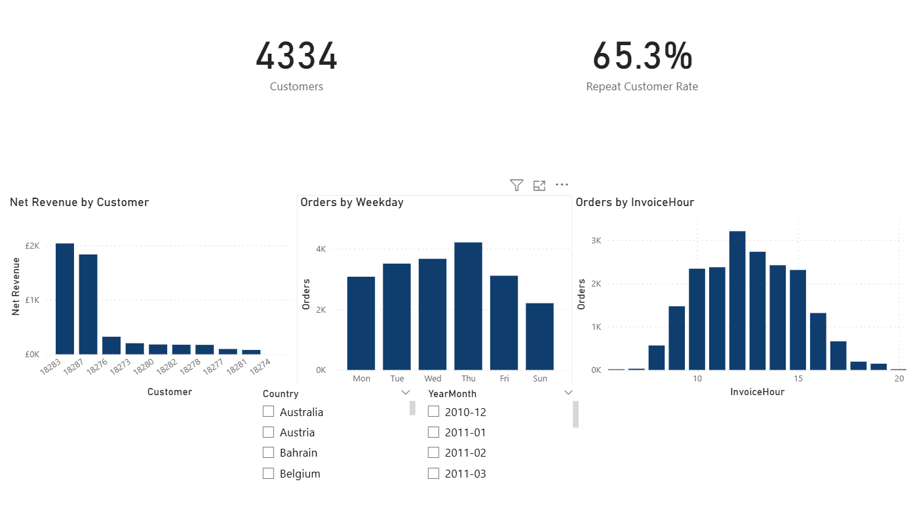

# retail-sales-PROJ# Online Retail Sales & Customer Analytics (Power BI)

An end-to-end Power BI analytics project built on a 2010–2011 online retail transaction dataset, modeled in a star schema with custom DAX measures, time intelligence, drillthroughs, custom tooltips and Row-Level Security (RLS).

---

## Executive Summary & Key Insights

* **Seasonal Peak:** Net revenue peaks in **November 2011 at £1.43M** (+34.4% MoM vs. October), with **September–November 2011 generating 35.8%** of total 13-month net revenue. *(Note: December 2011 reflects partial trading data through Dec 9, resulting in a -69.1% MoM comparison against full November trading.)*
* **Market Concentration:** The **United Kingdom** drives **84.8%** of net revenue (**£8.28M** of **£9.77M** total), followed by the **Netherlands (£283k)**, **EIRE (£259k)**, **Germany (£201k)**, **France (£182k)**, and **Australia (£137k)**.
* **Top Products:** Revenue leaders include **Regency Cakestand 3 Tier (£164k)**, **White Hanging Heart T-Light Holder (£99.8k)**, and **Party Bunting (£98.2k)**.
* **Customer Concentration:** Top individual customers include **Customer 14646 (£278.8k)**, **18102 (£259.7k)**, and **17450 (£189.6k)**, with the top 20% of identified customers contributing roughly **74%** of identified customer revenue.
* **Customer Loyalty:** **65%** of identified customers placed more than one order.
* **Returns & Data Gaps:** Returns represent **4.6%** of gross sales (handled via net vs. gross revenue logic so mistaken/return transactions do not distort gross figures), and **14.7%** of gross sales have no customer ID (guest/unidentified records).
* **Trading Patterns:** No orders occur on **Saturdays**; **Thursday** is the busiest day (**4,209 orders**) and **12:00 PM (noon)** is the peak ordering hour (**3,204 orders**).

---

## Data Model Architecture

* **Star Schema Design:** Central fact table (`FactSales`) connected via active one-to-many relationships to four dimension tables:
  * `DimDate` (marked as official Date Table for time intelligence)
  * `DimProduct` (stock codes and product descriptions)
  * `DimCountry` (geographic markets)
  * `DimCustomer` (customer identifiers, separating registered accounts from `"Guest"` records)

---

## Key DAX Measures

```dax
// Core Revenue & Volume
Gross Sales = CALCULATE(SUM(FactSales[LineTotal]), FactSales[LineType] = "Sale")
Returns Value = -CALCULATE(SUM(FactSales[LineTotal]), FactSales[LineType] = "Return")
Net Revenue = [Gross Sales] - [Returns Value]
Return Rate = DIVIDE([Returns Value], [Gross Sales])
Orders = CALCULATE(DISTINCTCOUNT(FactSales[InvoiceNo]), FactSales[LineType] = "Sale")
Units Sold = CALCULATE(SUM(FactSales[Quantity]), FactSales[LineType] = "Sale")
Avg Order Value = DIVIDE([Gross Sales], [Orders])
Customers = CALCULATE(DISTINCTCOUNT(FactSales[Customer]), FactSales[LineType] = "Sale", FactSales[Customer] <> "Guest")

// Time Intelligence
Net Revenue PM = CALCULATE([Net Revenue], DATEADD(DimDate[Date], -1, MONTH))
Net Revenue MoM % = DIVIDE([Net Revenue] - [Net Revenue PM], [Net Revenue PM])
Net Revenue YTD = TOTALYTD([Net Revenue], DimDate[Date])
Net Revenue 3M Avg = CALCULATE(AVERAGEX(VALUES(DimDate[YearMonth]), [Net Revenue]), DATESINPERIOD(DimDate[Date], MAX(DimDate[Date]), -3, MONTH))

// Market Share & Customer Retention
Country Share = DIVIDE([Net Revenue], CALCULATE([Net Revenue], ALL(DimCountry)))
Repeat Customers = COUNTROWS(FILTER(VALUES(FactSales[Customer]), FactSales[Customer] <> "Guest" && CALCULATE(DISTINCTCOUNT(FactSales[InvoiceNo]), FactSales[LineType] = "Sale") > 1))
Repeat Customer Rate = DIVIDE([Repeat Customers], [Customers])
```

---

## Report Pages & Interactive Features

1. **Overview:** Executive KPI cards (`Orders`, `Net Revenue`, `Return Rate`, `Avg Order Value`, `Customers`), monthly Net Revenue vs. 3-Month Moving Average line chart, conditional-formatted monthly MoM % table, Top 10 Export Markets bar chart (excluding the UK in export view for scale clarity), and synced slicers.
2. **Products:** Top 10 products by net revenue bar chart, Top 50 products performance table with data bars, units sold, and return rates, plus an AI Decomposition Tree.
3. **Customers:** Identified customer count and repeat customer rate KPIs, Top 10 customers bar chart, and order volume distributions by weekday and hour of day.
4. **Polish, Governance & Accessibility:**
   * Consistent report theme and uniform measure color mapping across all pages
   * Synced `Country` slicer across all report views
   * **Country Detail** drillthrough page triggered from the country bar chart
   * Custom **Product Tip** report-page tooltip showing `Net Revenue`, `Units Sold`, and `Return Rate`
   * Built-in **Page Navigator** buttons and a **Reset Filters** bookmark button
   * Descriptive **Alt Text** on all visuals and a dedicated **Mobile Layout**
   * **Row-Level Security (RLS)** role (`UK_Only`) tested via *View as* (`[Country] = "United Kingdom"`)

---

## Dashboard Preview


### Overview Page


### Products Page


### Customers Page
)

---

## Repository Contents

* `online-retail-analytics.pbix` — Complete Power BI Desktop report and data model
* `README.md` — Project documentation, key findings, and DAX reference
* `screenshots/` — High-resolution exports of report pages
